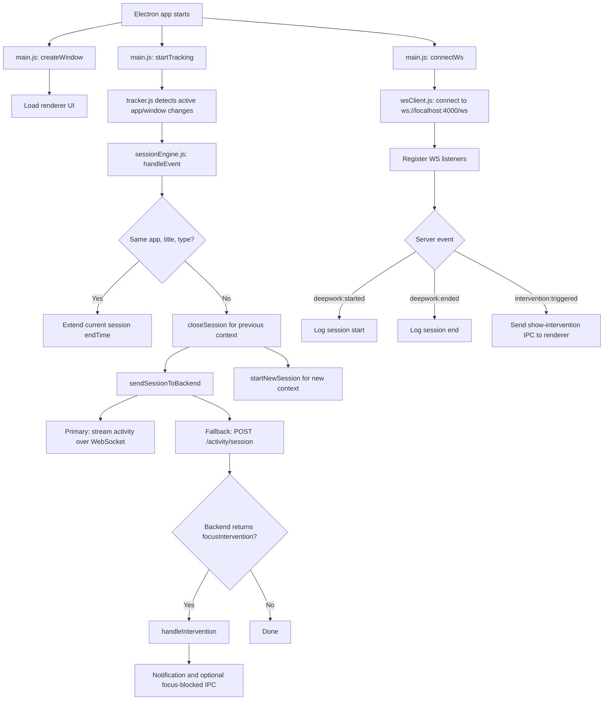
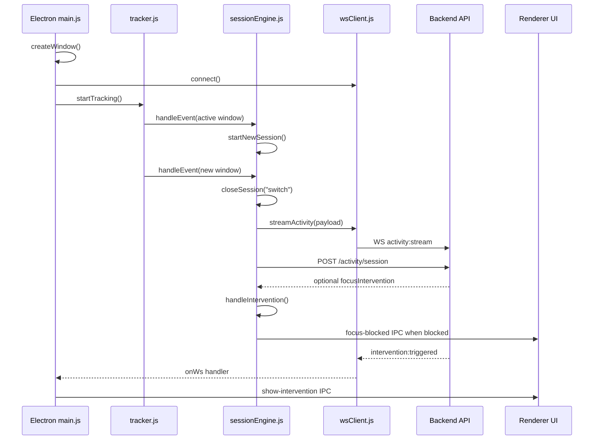

# Desktop Tracker Project Guide

This guide explains the desktop side of the tracker app based on these files:

- `main.js`
- `wsClient.js`
- `sessionEngine.js`
- `syncEngine.js`

The app is an Electron desktop client. Its job is to observe the active app/window, group observations into sessions, send those sessions to the backend, and react to deep-work interventions sent by the backend.

## High-Level Workflow



## Runtime Pieces

### Electron Main Process

`main.js` is the main entry point for the desktop application. It creates the app window, connects to the WebSocket backend, registers realtime listeners, and starts local activity tracking.

### WebSocket Client

`wsClient.js` owns the realtime connection to `ws://localhost:4000/ws`. It identifies the client with:

- `userId`: currently hard-coded as `7007b337-6f7b-4d6a-86f9-dc4da4ed48c4`
- `deviceId`: persisted in `electron-store`
- `clientType`: `desktop`

It sends activity events, subscribes/unsubscribes to deep-work sessions, dispatches incoming server messages to listeners, sends heartbeats, queues messages while offline, and reconnects with exponential backoff.

### Session Engine

`sessionEngine.js` keeps one active observation in memory as `currentSession`. When the active app/window changes, it closes the old session, calculates duration, sends it to the backend, and opens a new session.

It sends data in two ways:

- WebSocket primary route: `activity:stream`
- HTTP fallback route: `POST http://localhost:4000/activity/session`

If the HTTP fallback response includes a focus intervention, it shows a desktop notification and may send an IPC event to the renderer.

### Sync Engine

`syncEngine.js` is a periodic local-store sync mechanism. It reads stored sessions from `electron-store`, posts them to `POST http://localhost:4000/sync/sessions`, and clears the local `sessions` array after success.

In the current app boot flow, `startSyncLoop()` is imported in `main.js` but commented out, so this sync loop does not run unless that line is enabled.

## Routes And Message Channels

These are the backend routes and realtime channels visible in the desktop files.

| Type | Name | Direction | File | Purpose |
| --- | --- | --- | --- | --- |
| WebSocket URL | `ws://localhost:4000/ws?userId=...&deviceId=...&clientType=desktop` | Desktop to backend | `wsClient.js` | Opens the realtime desktop connection. |
| WS message | `ping` | Desktop to backend | `wsClient.js` | Heartbeat every 30 seconds while connected. |
| WS message | `activity:stream` | Desktop to backend | `wsClient.js`, `sessionEngine.js` | Streams a completed activity session. |
| WS message | `session:subscribe` | Desktop to backend | `wsClient.js` | Subscribes to deep-work state for a `deepWorkId`. |
| WS message | `session:unsubscribe` | Desktop to backend | `wsClient.js` | Unsubscribes from a deep-work session. |
| WS message | `deepwork:started` | Backend to desktop | `main.js` | Logs that a deep-work session started. |
| WS message | `deepwork:ended` | Backend to desktop | `main.js` | Logs that a deep-work session ended. |
| WS message | `intervention:triggered` | Backend to desktop | `main.js` | Sends an intervention to the renderer via IPC. |
| HTTP route | `POST /activity/session` | Desktop to backend | `sessionEngine.js` | Fallback delivery for completed sessions. |
| HTTP route | `POST /sync/sessions` | Desktop to backend | `syncEngine.js` | Legacy/offline batch sync for stored sessions. |
| IPC event | `show-intervention` | Main to renderer | `main.js` | Shows an intervention in the UI. |
| IPC event | `focus-blocked` | Main to renderer | `sessionEngine.js` | Tells the renderer that an app is blocked. |

## `main.js`

### Imports

- `app`, `BrowserWindow`, `ipcMain` from Electron.
- `path` for building preload/build file paths.
- `startTracking` from `tracker.js`, which is the activity collector used by the app.
- `startSyncLoop` from `syncEngine.js`, imported but currently not started.
- `connectWs` and `onWs` from `wsClient.js`.

`ipcMain` is imported but not used in this file.

### State

- `isDev`: true when the app is not packaged.
- `mainWindow`: holds the current Electron window instance.

### `createWindow()`

Creates the fixed-size desktop window:

- Width: `400`
- Height: `600`
- Resizable: `false`
- Uses `preload.js`
- Enables `contextIsolation`
- Disables `nodeIntegration`

Then it loads:

- `http://localhost:3000` in development
- `../renderer/out/index.html` when packaged

In development, it opens DevTools automatically. When the window closes, it clears `mainWindow`.

### `app.whenReady().then(...)`

This is the main startup sequence:

1. Calls `createWindow()`.
2. Calls `connectWs()` to open the WebSocket connection.
3. Registers WebSocket event handlers:
   - `deepwork:started`
   - `deepwork:ended`
   - `intervention:triggered`
4. Calls `startTracking()` to begin observing activity.
5. Leaves `startSyncLoop()` commented out.

### `onWs("deepwork:started", handler)`

Receives a deep-work session object from the backend and logs its `session.id`.

### `onWs("deepwork:ended", handler)`

Logs that deep work ended.

### `onWs("intervention:triggered", handler)`

Receives an intervention from the backend. It logs the intervention action and app name, then sends `show-intervention` to the renderer if `mainWindow` still exists.

### `app.on("window-all-closed", handler)`

Quits the app when all windows are closed, except on macOS where apps usually remain active until explicitly quit.

### `app.on("activate", handler)`

On macOS-style activation, recreates the main window if no windows are open.

## `wsClient.js`

### Constants And Persistent Identity

- `WS_URL`: `ws://localhost:4000/ws`
- `USER_ID`: hard-coded user id.
- `DEVICE_ID`: read from `electron-store`; generated with `uuid.v4()` if missing; then persisted.

This means the device keeps the same identity across app restarts.

### State

- `ws`: current WebSocket instance.
- `reconnectTimer`: timeout used for reconnect attempts.
- `reconnectAttempt`: count used to calculate exponential backoff.
- `messageQueue`: messages waiting to send while disconnected.
- `isConnected`: boolean connection flag.
- `listeners`: `Map` of message type to handler set.
- `heartbeatInterval`: interval for periodic pings.

### `connect()`

Opens the WebSocket connection unless one is already open or connecting.

The connection URL includes `userId`, `deviceId`, and `clientType=desktop`.

Event behavior:

- `open`: resets reconnect state, marks connected, flushes queued messages, starts heartbeat.
- `message`: parses JSON and passes it to `handleMessage()`.
- `close`: marks disconnected, stops heartbeat, schedules reconnect.
- `error`: logs the error and marks disconnected.

### `disconnect()`

Stops heartbeat, clears any scheduled reconnect, closes the socket, clears local socket state, marks disconnected, and resets reconnect attempts.

### `scheduleReconnect()`

Schedules reconnect using exponential backoff:

- Starts at `1000ms`
- Doubles per attempt
- Caps at `30000ms`

It avoids scheduling multiple reconnect timers at once.

### `startHeartbeat()`

Every 30 seconds, sends:

```json
{ "type": "ping", "payload": {} }
```

Only sends when the socket is open.

### `stopHeartbeat()`

Clears the heartbeat interval.

### `handleMessage(msg)`

Dispatches incoming backend messages.

It calls:

- All listeners registered for `msg.type`, passing only `msg.payload`.
- All wildcard listeners registered under `"*"`, passing the whole message.

Listener errors are caught and logged so one bad handler does not break dispatch for others.

### `send(type, payload)`

Serializes a message as:

```json
{ "type": "...", "payload": {} }
```

If the socket is open, it sends immediately. Otherwise, it pushes the serialized message into `messageQueue` so it can be flushed after reconnect.

### `on(type, handler)`

Registers a listener for a message type. It returns an unsubscribe function that removes that handler.

Example:

```js
const unsubscribe = on("intervention:triggered", handler);
unsubscribe();
```

### `off(type, handler)`

Removes a specific listener from a message type.

### `streamActivity(activity)`

Sends activity to the backend using the `activity:stream` WebSocket message.

It adds the hard-coded `USER_ID` to the activity payload.

### `subscribeToDeepWork(deepWorkId)`

Sends:

```json
{ "type": "session:subscribe", "payload": { "deepWorkId": "..." } }
```

### `unsubscribeFromDeepWork(deepWorkId)`

Sends:

```json
{ "type": "session:unsubscribe", "payload": { "deepWorkId": "..." } }
```

### Exports

Exports connection controls, message send/listener helpers, activity/deep-work helpers, and a getter for `isConnected`.

## `sessionEngine.js`

### Constants And State

- `currentSession`: the active in-memory session, or `null`.
- `MIN_SESSION_DURATION`: `2000ms`; sessions shorter than this are discarded.
- `USER_ID`: hard-coded user id.
- `BACKEND_URL`: `http://localhost:4000/activity/session`

### `now()`

Small wrapper around `Date.now()`.

### `startNewSession(event)`

Creates a new `currentSession` from an activity event.

Fields copied into the session:

- `startTime`
- `endTime`
- `app`
- `title`
- `icon`
- `url`
- `domain`
- `type`

If `event.startTime` exists, it is used. Otherwise, current time is used. `type` defaults to `"active"`.

### `sendSessionToBackend(session)`

Builds the payload for a completed session:

- `userId`
- `app`
- `title`
- `iconUrl`
- `url`
- `domain`
- `startTime` as ISO string
- `endTime` as ISO string
- `duration`
- `type`

Then it sends the payload two ways:

1. Primary: `streamActivity(payload)` over WebSocket.
2. Fallback: HTTP `POST` to `http://localhost:4000/activity/session`.

If the HTTP response is OK, it tries to parse JSON. If the response includes `focusIntervention`, it passes that to `handleIntervention()`.

If HTTP fails, the error is logged. The code assumes the WebSocket stream already attempted delivery.

### `handleIntervention(focusIntervention, appName)`

Handles backend focus-enforcement decisions.

It reads:

- `intervention`
- `enforcement`
- `message`

The action is determined from `intervention.action`, then `enforcement`, then `"observe"`.

Supported actions:

- `blocked` or `block`: shows a critical notification and calls `blockDistractingWindow(appName)`.
- `warned` or `warn`: shows a warning notification.
- `observed` or `observe`: logs the observation only.
- `reason_required`: shows a notification asking for justification.

### `blockDistractingWindow(appName)`

Logs that the app is being blocked, finds the first Electron window, and sends `focus-blocked` to the renderer with:

- `appName`
- `message`

This does not itself kill or close the distracting app. It tells the renderer to display blocking UI.

### `closeSession(reason = "active", endTimeOverride = null)`

Closes the current session if one exists.

Steps:

1. Uses `endTimeOverride` if supplied; otherwise uses current time.
2. Ensures `endTime` is never before `startTime`.
3. Calculates duration.
4. Drops the session if duration is under `2000ms`.
5. Adds `duration` to `currentSession`.
6. Sends the session to backend with `sendSessionToBackend()`.
7. Clears `currentSession`.

The `reason` is logged but not included in the backend payload.

### `handleEvent(event)`

Main entry point used by the activity tracker.

It calculates the event start time, then:

- If no current session exists, starts one.
- If the event has the same `app`, `title`, and `type`, it extends the current session.
- If app/title/type changed, it closes the current session using the new event's start time as the previous session's end time, then starts a new session.

This is what turns a stream of active-window observations into clean activity sessions.

### `app.on("before-quit", handler)`

Before Electron quits, it closes any active session with reason `"shutdown"`.

### Crash Protection

The file registers process-level handlers:

- `uncaughtException`
- `unhandledRejection`

Both log the problem so unexpected failures are visible.

### Exports

Exports:

- `handleEvent`
- `closeSession`

## `syncEngine.js`

### Constants And Device Identity

- Uses `electron-store` for local storage.
- Reads or generates `deviceId`.
- Persists `deviceId`.
- Uses `CLOUD_API = "http://localhost:4000"`.

### `sync()`

Reads `sessions` from local store.

If there are no sessions, it returns immediately.

If sessions exist, it posts to:

```text
POST http://localhost:4000/sync/sessions
```

Each session is copied and assigned a new UUID as `id`.

After successful sync, it clears the local `sessions` array. If the request fails, it logs that sync failed and leaves the sessions in storage for a future retry.

### `startSyncLoop()`

Runs `sync()` every 4 seconds with `setInterval`.

This function is currently not active because `main.js` has `//startSyncLoop();` commented out.

### Exports

Exports:

- `startSyncLoop`

## End-To-End Session Lifecycle



## Important Notes

- There are two different delivery mechanisms for activity sessions: WebSocket streaming and HTTP fallback.
- `syncEngine.js` appears to be a separate older/offline sync path and is currently disabled at startup.
- `USER_ID` is hard-coded in both `wsClient.js` and `sessionEngine.js`.
- `DEVICE_ID` is persisted in both `wsClient.js` and `syncEngine.js` using the same `electron-store` key.
- `sessionEngine.js` imports `shell` from Electron but does not use it.
- `main.js` imports `ipcMain` but does not use it.
- `blockDistractingWindow()` does not directly block an external app; it sends an IPC message to the app UI.
